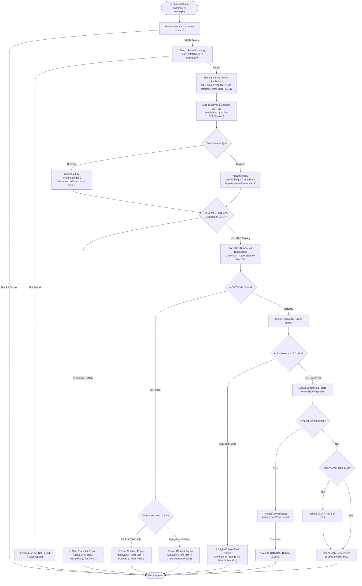

# 🚀 Automated Multi-Vendor OLT VLAN Troubleshooter (SecureCRT)

A modular, closed-loop Network Operations Center (NOC) automation tool built for **SecureCRT (Python 2.7 engine)**. Designed to eliminate manual spreadsheet lookups and repetitive CLI checks when troubleshooting corporate client Layer-2 VLAN and GPON ONT/ONU complaints across **BDCOM** and **Huawei** OLTs.

---

## ⚡ Problem Statement vs. Automated Solution

* **Manual NOC Workflow (~3–4 mins/ticket):** Search VLAN ID in a spreadsheet $\rightarrow$ Find OLT hostname & GPON port $\rightarrow$ Locate OLT session in SecureCRT $\rightarrow$ Log in & enter enable mode $\rightarrow$ Check VLAN MAC table $\rightarrow$ Check ONT/ONU state $\rightarrow$ Check optical Rx power (dBm) $\rightarrow$ Check running configuration $\rightarrow$ Manually format ticket update.
* **Automated Workflow (~3 seconds/ticket):** Click one button in SecureCRT $\rightarrow$ Enter VLAN ID $\rightarrow$ Script automatically parses inventory, connects to the target OLT, executes multi-vendor L1/L2/Config diagnostics, offers one-click remediation (VLAN profile binding or ONT reboot), and generates a pre-highlighted clipboard summary.

---

## 📊 Updated Architecture & Troubleshooting Flowchart



---

## 📂 Modular Project Structure

The codebase is separated into single-responsibility modules for easy maintenance and multi-vendor scalability:

```text
corporate-client-vlan-automation/
│
├── main.py                # Entry point bound to SecureCRT Button Bar; orchestrates workflow
├── crt_helper.py          # Reusable SecureCRT wrapper (Session auto-discovery, CLI send/capture, popups)
├── vlan_extractor.py      # Parses clients.csv and splits GPON port formats (BDCOM 0/1:46 vs Huawei 0/1/12:98)
├── bdcom_olt.py           # BDCOM GPON diagnostic & auto-remediation logic
├── huawei_olt.py          # Huawei GPON diagnostic & auto-remediation logic
├── clients.example.csv    # Sanitized sample inventory template
└── .gitignore             # Excludes live client data (clients.csv) from version control
```

---

## 🛠️ Key Engineering Features

* **Multi-Vendor CLI Abstraction:** Automatically detects `bdcom` vs. `huawei` from the inventory and executes vendor-specific syntax, pagination handling (`terminal length 0` vs. `screen-length 0 temporary`), and `<cr>` carriage-return prompts[cite: 8].
* **Smart SecureCRT Session Auto-Discovery:** Walks the local `%APPDATA%\VanDyke\Config\Sessions` directory to locate matching `.ini` session files even if session names contain IP suffixes or nested folders, with automatic SSH2 IP fallback.
* **Clean CLI Output Filtering:** Strips trailing OLT hostname prompts from captured MAC tables before displaying results.
* **One-Click Clipboard Reporting:** Uses pre-highlighted `crt.Dialog.Prompt` modals on failure states (`LOS`, `DyingGasp`, `High dBm Loss`) so NOC engineers only press `Ctrl+C` to copy formatted ticket updates.
* **Safe Closed-Loop Remediation:** Checks optical health (`-27.0 dBm` threshold) before evaluating port configurations, and requires explicit engineer confirmation (`Yes/No`) before rebooting an ONT or applying missing VLAN profiles[cite: 2].

---

## ⚙️ Setup & Usage in SecureCRT

1. Clone this repository to your local machine:
   ```bash
   git clone [https://github.com/](https://github.com/)<your-username>/corporate-client-vlan-automation.git
   ```
2. Copy `clients.example.csv` to `clients.csv` and populate your active VLAN inventory:
   ```csv
   SL_No,Active_Date,Address,VLAN,OLT_Name,Vendor,OLT_IP,PON_Port,ONU_SN,Status
   1,01/01/2026,"Sample Corporate Branch A",1941,sample-block-olt2,bdcom,10.0.0.10,0/1:46,HWTC:12345678,Active
   2,02/01/2026,"Sample Corporate Branch B",1976,sample-huawei-olt1,huawei,10.0.0.20,0/0/2:79,4857544312345678,Active
   ```
3. Open **SecureCRT** $\rightarrow$ Enable the Button Bar (**View $\rightarrow$ Button Bar**).
4. Right-click the Button Bar $\rightarrow$ **New Button...**
   * **Function:** `Run Script`
   * **Script File:** Select `main.py`
   * **Label:** `🔍 VLAN Check`
5. Click the button, enter a VLAN ID, and let the script handle the rest!